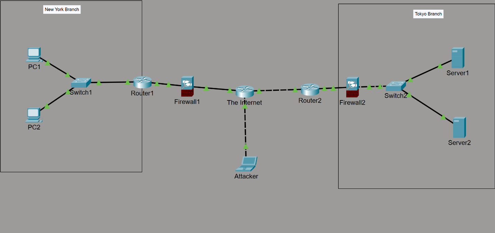
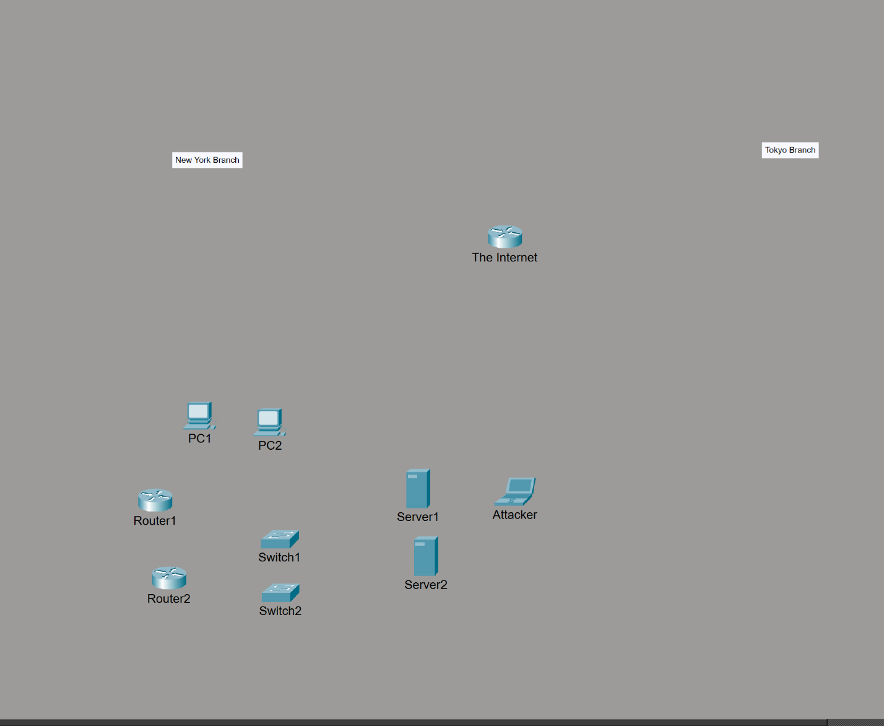
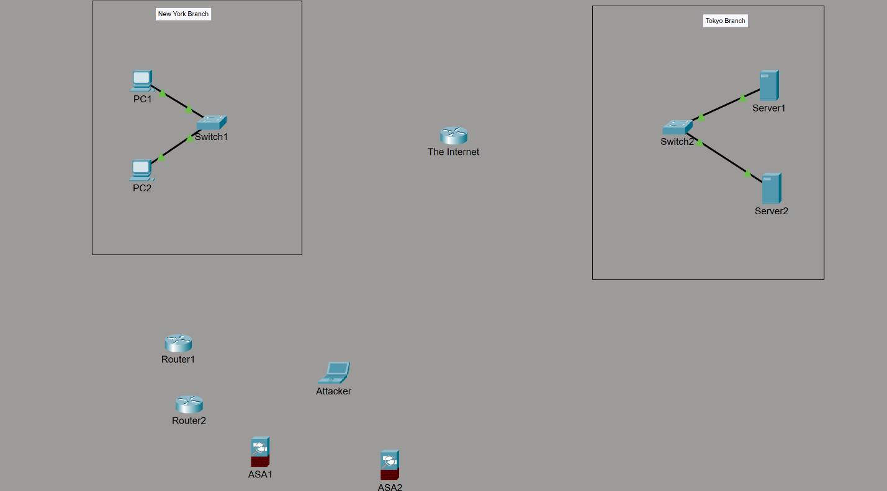
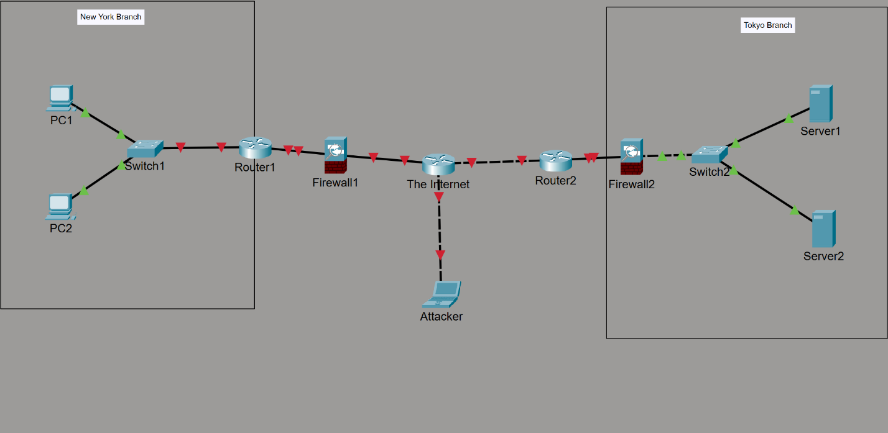
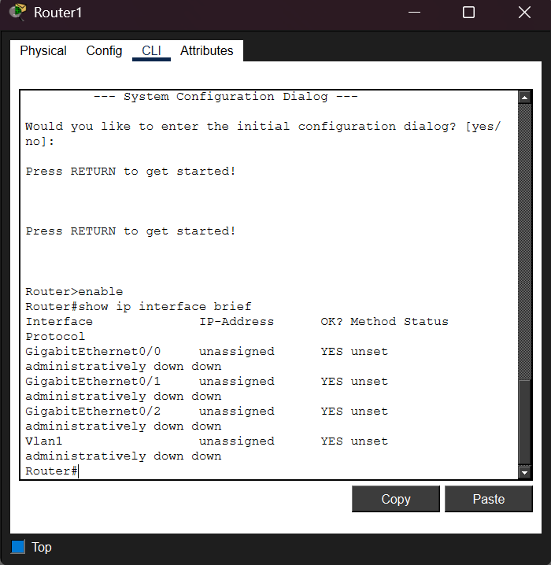
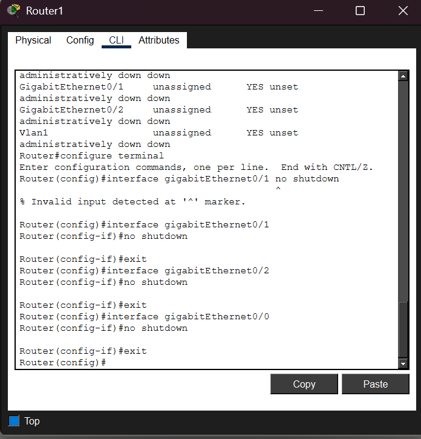
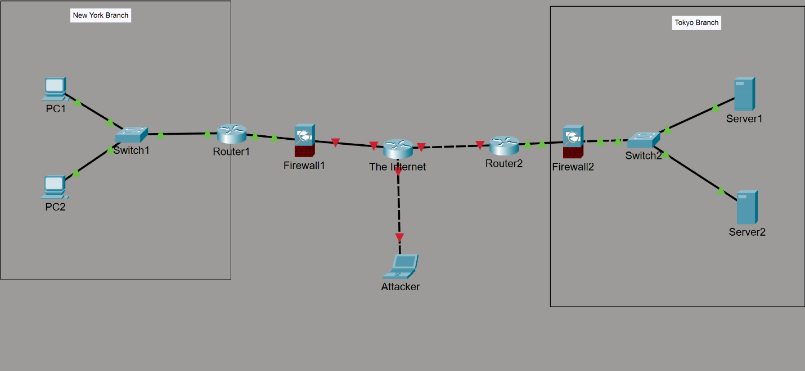

# LAN-to-LAN Network Topology Setup & Interface Troubleshooting

**Cisco Packet Tracer | Network Topology Design | Cisco IOS | Interface Troubleshooting**

## Project Overview

This project documents the construction of two separate local area networks (LANs), representing **New York** and **Tokyo**, connected through simulated Internet infrastructure. I placed client PCs, servers, switches, routers, firewalls, and an external attacker endpoint in Cisco Packet Tracer.

During setup, multiple links remained down. I used `show ip interface brief` to identify **administratively disabled router interfaces**, then applied `no shutdown` on the required ports. The final topology shows active (green) link indicators.

> **Project scope:** This lab focuses on laying out and connecting the devices in a two-branch network topology and bringing the relevant router interfaces online. IP addressing and routing were not part of this exercise.

## Lab Objectives

- Build two LAN segments and a simulated inter-site connection.
- Understand how switches, routers, and firewalls fit into the topology.
- Diagnose disabled Cisco IOS interfaces.
- Enable the required interfaces and observe their link states.
- Document troubleshooting decisions and outcomes.

## Lab Environment

| Device | Role |
| --- | --- |
| Cisco Packet Tracer | Network simulation environment |
| PC1 and PC2 | New York LAN endpoints |
| Server1 and Server2 | Tokyo LAN endpoints |
| Switch1 and Switch2 | Local access switching |
| Router1 and Router2 | Branch routing devices |
| Intermediate router ("The Internet") | Simulated inter-site transit |
| Firewall1 and Firewall2 | Security devices in the proposed path |
| Attacker endpoint | Simulated external host; no attack tests documented |

*This was a topology setup exercise; no IP addressing or routing configuration was performed.*

## Topology

```text
New York LAN                                        Tokyo LAN
PC1 --\                                               /-- Server1
      Switch1 -- Router1 -- Firewall1 -- Internet -- Router2 -- Firewall2 -- Switch2
PC2 --/                          |                    \-- Server2
                              Attacker
```

*This diagram is conceptual; consult the screenshot for the precise topology.*



## Implementation and Troubleshooting

### 1. Place the devices

I started by placing the required routers, switches, hosts, servers, and other devices in the Packet Tracer workspace, grouping them by branch.



### 2. Build the two LANs

I connected the New York PCs to Switch1 and the Tokyo servers to Switch2. The local Ethernet links turned green, indicating active links in the simulation. This indicated that the locally connected ports were active.



### 3. Add the inter-site devices

I added the branch routers, firewall appliances, intermediate Internet router, and external endpoint. Several links were red, so I investigated interface status.

The routers represent the connection points between the branch LANs and the simulated Internet. The firewalls were included to illustrate where network security controls could be placed in the topology.



### 4. Diagnose the router interfaces

I opened the Cisco IOS command-line interface and ran:

```cisco
Router> enable
Router# show ip interface brief
```

The output indicated that several interfaces were **administratively down**, meaning they were disabled through configuration.



### 5. Enable the required branch interfaces

I entered configuration mode and enabled the relevant interfaces on both Router1 and Router2.

```cisco
Router> enable
Router# configure terminal
Router(config)# interface gigabitEthernet0/0
Router(config-if)# no shutdown
Router(config-if)# exit
Router(config)# interface gigabitEthernet0/1
Router(config-if)# no shutdown
Router(config-if)# exit
Router(config)# interface gigabitEthernet0/2
Router(config-if)# no shutdown
Router(config-if)# exit
Router(config)# end
Router# show ip interface brief
```

*The commands above are a cleaned-up example of the documented procedure. Enable only interfaces actually connected and intended for use. `no shutdown` does not by itself guarantee an `up/up` state.*



### 6. Isolate the remaining down links

The branch-router links improved, but the connections around the intermediate Internet router remained red. I identified that router as the next device requiring investigation.



### 7. Enable the intermediate router interfaces

I repeated the interface checks and enablement process on the intermediate router. The final Packet Tracer screenshot showed all depicted link indicators green.

**Result:** The network layout was completed and the previously disabled interfaces were enabled, with green link indicators visible across the final topology.


## Troubleshooting Summary

| Issue | Diagnostic finding | Corrective action | Observed result |
| --- | --- | --- | --- |
| Red links on branch routers | Interfaces shown as administratively down | `no shutdown` on relevant router ports | Some links became active |
| Red links near Internet device | Intermediate router interfaces still required configuration | Enabled connected interfaces | Final topology showed green links |

## Skills Practiced

- Cisco Packet Tracer topology construction
- LAN architecture fundamentals
- Cisco IOS interface status checks
- Identifying `administratively down` interfaces
- Interface configuration using `no shutdown`
- Methodical network troubleshooting
- Building and documenting a simulated multi-site network topology

## Project Outcome

The New York and Tokyo LANs were laid out with PCs, servers, switches, routers, firewalls, and a simulated Internet connection. After troubleshooting administratively disabled router interfaces, the final Packet Tracer topology displayed green links. The objective of this exercise was **topology assembly and interface setup**, not configuring IP addressing or routing.

---

*Expanded and reorganized from my original Cisco Packet Tracer lab notes.*
